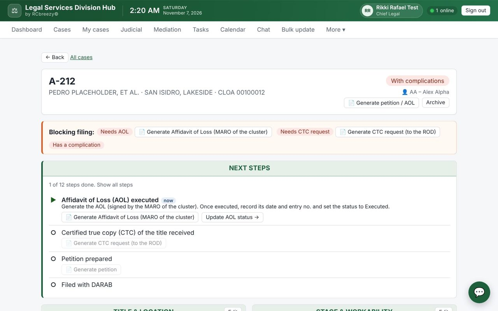

# Hi, I'm Rikki Cabanlet (RCbreezy)

I build web apps for people who live with paperwork: case files, records, documents, schedules and approvals. I'm a legal assistant in a government legal office in Cagayan de Oro and a law student, so I know these workflows from the inside.

**How I build:** with AI-assisted coding (Claude Code). I design the app, write the spec, review every change, and test it on real devices. Every change goes through automated tests before it goes live.

## Apps

### Demo Hub: a customizable office hub
One place for an office's records, documents, people and calendar. Clients can make it theirs in minutes: name, colors, ranks, record types and stages.

- **Documents from your own Word files:** color the parts that change in red, and the Hub fills them in from a record.
- **Ranks and roles,** enforced in the database: "View as" shows in seconds what each rank can see.
- **Calendar with Google Calendar sync:** each person sees only the events their rank allows.
- **Also:** a library with watermarks and approved downloads, a bulletin, chat, and finance.
- 🌐 **[Try it: start your own demo](https://rc-demo-hub.web.app)**. You get a private copy with made-up data, deleted automatically afterwards.
- React, TypeScript, Firebase (Auth, Firestore, Cloud Functions), Google Calendar API. Code is private.
- **In progress:** a law firm edition, where court emails become proposed hearings on the right case's calendar, confirmed by a lawyer.

### LSD Hub: case monitoring for a government legal division (private)
A live case monitoring app for my own legal division. It replaced a 23-tab spreadsheet whose totals didn't agree with one live source of truth for about 1,800 cases.

- Every case shows its next steps, with buttons that generate the documents it needs.
- A dashboard where every number opens the cases behind it, plus automatic checks for data problems.
- Invite-only sign-in, roles in the database rules, a history of every change, and over 290 automated tests.
- Built with my division chief's approval. Private: it holds real government records, so there's no public link. The screenshot below uses made-up test data.

### The Vault: a budget app that runs on payday
For people paid twice a month: every bill is assigned to the paycheck that will pay it, loans become a payment schedule split across paychecks, and the same data syncs between phone and computer within a second.

- 👀 **[Try the demo, no account needed](https://thevault-rc.web.app/?demo)** · [Live app](https://thevault-rc.web.app)
- React, Rust compiled to WebAssembly, Firebase. Installable on iPhone, Android and computers; works offline. Code is private.

### Breezy Docket: plan every semester to graduation
For working students who can't take a full load: it plans the remaining subjects under a unit cap, follows prerequisites, moves everything that depends on a failed subject, and shows the graduation date.

- 🌐 **[Live app](https://rikkirc.github.io/breezy-docket/)** · [Code](https://github.com/rikkirc/breezy-docket)
- React, TypeScript, Firebase. Sign-in with consent and a privacy notice written for the Data Privacy Act of 2012. 130 automated tests.

### A members' app for a law fraternity (private)
A private app for an organization with 5 chapters and about 500 members:

- officer approval of new members, and roles that expire every election year;
- a shared library of notes and past exams, with watermarking and approved downloads;
- a bulletin and a member directory.

Private: built for the organization, not public. A walkthrough is available on request. React, TypeScript, Firebase, Google Drive. Over 400 automated tests, most of them checking who can see or do what.

### Law School - Bukol: a Philippine law trivia game (in progress)
Quick rounds of codal questions for law students, with practice by topic and ranked play.

- 🌐 [Live, in progress](https://law-school-bukol.web.app)
- React, TypeScript, Firebase with server-side scoring. Code is private.

## What I can build for you
- Record-keeping and tracking apps: case files, documents, members, requests, approvals.
- A hub for your office or firm: records, documents from your own Word templates, ranks, and a shared calendar.
- Apps with accounts and roles (who can see and approve what), on phone and computer.
- Privacy built in from the start: consent, privacy notice, access rules, and only the data you need.

## Contact
📧 rikkicabanlet@gmail.com · Cagayan de Oro City, Philippines
